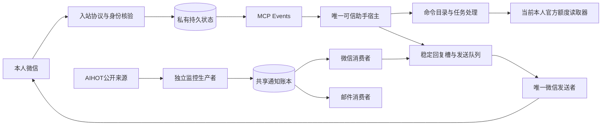

# 重构设计

目标是让一个项目可解释、可验证、可接续地承载本人微信助手与 AIHot 通知。保留现有消息身份、状态机和外部工具契约，按职责拆分代码，再逐项关闭实际功能缺口。

## 数据路径

图中的箭头表示接口与数据依赖，不表示所有宿主能力均已部署。额度 reader 由当前可信宿主提供；桥接不自行发现账户凭据。AIHot 两种通知的启用、切点与回执独立保存。

## 模块边界

|层|职责|重要约束|
|---|---|---|
|微信协议|请求/响应编码、加密上传配合、网络错误分类|保持原接口及有限请求；异常不能当“未发送”|
|入站捕获|owner与来源校验、完整性、引用、附件、首次入库|同一来源不改旧捕获；事务内保存消息与游标|
|出站派发|选取待发送项、稳定ID、限额、发送终态|唯一发送者；unknown不自动重发|
|命令层|不可变目录、保守上下文判断、展示|分类提示不等于发送权限；引用/附件不变成新命令|
|宿主协调|当前消息核验、任务选择、官方能力适配、幂等提交|调用真实可用工具；拒绝与unknown不能切换身份绕开|
|MCP接口|schema、RPC路由、精简投影、安全诊断|原schema与公开入口兼容，诊断不含正文或凭据|
|运行层|回调固定IP、线程唤醒、stdio排空、独占锁|单实例与原订阅接续，不以新副本开启第二发送者|
|AIHot来源|采集公开来源、判断预告/确认、生成共享事件|源码不携带私人路径/任务ID；默认不发通知|
|AIHot消费|按路由/代际/切点领取并提交|微信和邮件分别授权，历史与未知记录不回放|

`WeixinStore` 和 `Probe` 继续提供原入口。历史测试依赖的 patch 点及数据库格式保留；拆分模块通过明确依赖连接，避免导入时创建线程、连接或账号读取。

## 从证据到实施

1. 从最新冻结源码逐文件校验迁移，保存原版本与来源清单；运行基线全套测试。
2. 将命令解析/校验/展示、微信入站/发送/协议、MCP路由/传输/诊断/生命周期分离。
3. 对可复现问题补行为回归；新样本尚缺的线上命令字段问题单独记录。
4. 把 AIHot 独立生产者纳入通用目录，删除私人默认值，用显式配置接入既有消费者。
5. 通过固定文件导出、哈希、隐私扫描、schema、全量离线测试和独立代码复审形成发布候选。
6. 待真实接续条件满足后按 MIGRATION.md 单实例部署，并逐项收集手机与通知收件证据。

迁移覆盖源码与文档，不通过复制生产数据库来伪造新环境成功。原运行数据保留于原安装位置；私有交接索引不随公开包发布。

## 状态与失败处理

微信发送状态与 AIHot 来源确认分属不同系统。AIHot 确认“额度已重置”不证明通知已送到手机；微信 `accepted` 也不证明来源判断正确。界面和报告分别标记来源、队列、API和收件。

跨网络无法依赖一个数据库事务保证两端恰好一次。保留 stable ID 和原 attempt；丢失返回时转入 unknown，并对账原记录。停机与重启保持原账本，不创建新通知ID来补发。

公开范围固定为源码、合成测试、通用示例和许可证。未知文件、私有目录、符号链接、历史夹具变化均拒绝导出；不把扫描零发现当作免人工审阅。
