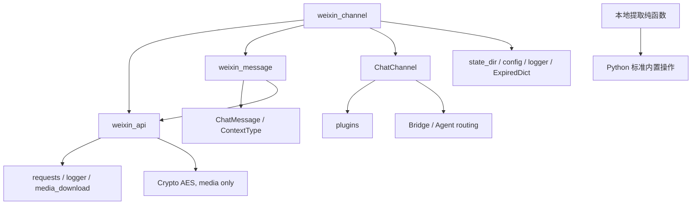

# CowAgent 来源、提取范围与升级边界

本轮读取日期：2026-11-06。上游：[zhayujie/CowAgent](https://github.com/zhayujie/CowAgent)，默认分支 `master`，固定审计 commit **`19e84350d6c5459133fc7d0c573d1b6600e55ff7`**。以下结论来自该版本实际源码，不把以后 master 的内容归于本次审计。

许可证为 MIT，版权声明 `Copyright (c) 2022 zhayujie`；完整原文保存在 [licenses/CowAgent-MIT.txt](../licenses/CowAgent-MIT.txt)。来源 URL、Git blob SHA、原始内容 SHA-256、提取函数及本地变化见 [manifest](../upstream/CowAgent/manifest.json)。下载文本已按 Git blob 对象哈希逐项核实；本项目不声明上游官方背书。

## 本次实际复用

`foundation/weixin_protocol.py` 直接适配以下两个纯函数，且注明来源与 MIT；没有运行或导入 CowAgent 模块、Agent 引擎或账号状态。

| 上游固定源码 | 实际提取 | 本地改动与约束 |
|---|---|---|
| [weixin_channel.py](https://github.com/zhayujie/CowAgent/blob/19e84350d6c5459133fc7d0c573d1b6600e55ff7/channel/weixin/weixin_channel.py#L1091) `WeixinChannel._split_text`，1091–1107行 | `split_text(text, limit)` | 保留段落/换行优先切分及边界换行移除行为；增加字符串和正整数 limit 校验，避免上游 limit=0 的不前进循环。4000字符是此上游版本的策略常量，不能说是本轮独立核实的官方限制。分片只产生数据，不授予多发消息权限 |
| [weixin_api.py](https://github.com/zhayujie/CowAgent/blob/19e84350d6c5459133fc7d0c573d1b6600e55ff7/channel/weixin/weixin_api.py#L399) `_aes_ecb_padded_size`，399–401行 | `aes_ecb_padded_size` | 保留 PKCS#7 整块大小公式；增加非负整数校验。它只计算长度，不声称已实现或验证实际加密/媒体传输 |

另保留该版本 `weixin_message.py` 中1–5的消息类型常量以明确来源；没有复制消息构造器的随机ID回退、网络下载或引用拼接。现有 `probe/weixin_protocol.py`、真实连接和生产消费者未替换；新的纯模块不启动任何服务。

差分测试把这两段原函数的 AST 保存为有版权说明和固定哈希的纯函数夹具，只在离线受限命名空间执行函数定义，不执行上游模块初始化或 imports。相同合法输入逐项比较；无效参数则检查本地新增的明确拒绝。上游函数引用/原始哈希变更需要人工审查，不能只更新预期值。

## 微信源码依赖图

`WeixinChannel` 继承 `ChatChannel`，其 `produce` 会进入 `Bridge().get_agent_bridge()` 和 Agent 路由；引用上游通道类会把插件、配置、工作区、任务和日志体系一同带入。`WeixinMessage` 构造时可能立即下载图片或混合媒体；它不是独立的纯消息解析器。上游 requirements 同时包含多种通道与模型依赖；本次没有整份安装。

## 审计与采用决定

| 能力/具体实现 | 上游证据 | 本地决定 |
|---|---|---|
| 扫码授权 | `WeixinApi.fetch_qr_code` / `poll_qr_status`；`WeixinChannel._qr_login` | 参考接口和失效状态，保留现有已绑定登录路径；不触发新扫码、不迁移凭据 |
| 账号/context保存 | `_save_credentials` 使用固定 `.tmp` + `os.replace`，chmod失败被吞；`_persist_context_tokens_locked` 读改写同一文件 | 保留本项目私有持久状态与受检入口。上游原子rename不等于跨进程事务或完整崩溃恢复；本轮不采用此凭据写法 |
| 登录独占 | `_ADOPT_LOCK=threading.Lock()`、`_ACTIVE_LOGINS` 进程内字典 | 只约束同一进程；不能声称同Bot跨进程单消费者。保留现有 `service_runtime.py` 的文件锁与单实例启动方式 |
| 入站去重 | `__init__` 使用 `ExpiredDict(60*60*7.1)`，`_process_message` 检查并写入内存 | 重启会失去该去重集合；不替换现有持久 inbox/事件唯一键 |
| 游标 | `_poll_loop` 先更新内存 `_get_updates_buf`，再逐条 `_process_message` | 不具备“消息落盘+游标提交”的同一事务。保留现有 `probe/weixin_inbound.py` 的持久入站事务，不复制此顺序 |
| 稳定消息ID | `WeixinMessage.__init__` 在 message_id/seq缺失时随机生成ID | 不采用随机回退；不能用随机值证明重启后同一事件去重 |
| 引用与媒体解析 | `WeixinMessage.__init__` 将引用文本拼入content；构造/prepare可能下载媒体 | 保留现有正文/引用/附件分开捕获和命令上下文检查，不把引用或附件当新指令；后续媒体适配需独立审核 |
| 长轮询恢复 | `get_updates` 把read timeout当空poll；`_poll_failure_delay` 有封顶退避；`_poll_loop` 处理-14并重新扫码一次，失败后等待重新连接 | 参考错误分层和有界退避，不自动启动登录/二维码或覆盖原凭据 |
| 发消息重试 | `WeixinApi._post` 不重试ReadTimeout，但可重试ConnectTimeout/SSLError/ConnectionError/ChunkedEncodingError；`send_text`/`_send_items` 传 `SEND_RETRIES=2` | 不采用上游重试策略。部分连接/响应异常也可能发生在上游已接受之后；现有 stable发送键、accepted/rejected/UNKNOWN账本继续负责，UNKNOWN不得盲重发 |
| send返回检查 | `_check_send_response` 对非零ret/errcode只记录日志；`_send_text` 捕获异常后返回None | 不能用这种None返回或“Text sent”日志证明API接受。保持现有明确发送结果状态与原final槽 |
| CDN与加密 | 上传采用requests、Crypto AES和CDN session；下载/回复媒体沿其它模块的限额与URL工具 | 仅提取纯长度公式；不复制CDN TLS密码套件降级或扩大下载/日志范围，现有媒体路径优先 |
| 日志 | `_process_message` 输出from_user和正文前50字符；其它路径可能输出context/响应错误 | 不复用正文/账号日志策略，普通日志仅固定状态和脱敏元数据 |

上游文档中24小时主动窗口、最低客户端版本等信息是**该固定版本文档的声明**，不是本轮真人生产验证结果。实际本地限制还须以当前官方能力和新请求结果核对；不能凭文档给主动推送授权。

## 对标与实施归属

| 对标项 | 上游范围 | 本项目本轮处理 |
|---|---|---|
| 微信文字/媒体 | 通道及API支持文字、图片、文件、视频；语音接收/转写另有处理 | 保留现有probe能力；本次纯函数测试不作为媒体端到端PASS |
| 恢复/持久化 | 上述轮询/凭据逻辑；去重和cursor内存边界 | 采用本地持久核心，避免退化为上游内存模型 |
| 模型配置、多轮与任务 | 依赖Bridge/Agent routing | 由独立backend接口及各自会话负责，不复制整套Agent |
| Tools/Skills、MCP | 通道继承链进入上游plugins/Agent | 作为后续可选模块，不能据通道提取声称兼容全部插件 |
| 记忆、知识库、调度 | 上游Agent/管理系统能力 | 独立对标待办；未引入工具执行或第二调度器 |
| 本地管理界面 | CowAgent自身管理入口 | 复用现有Mac工作台方向；不部署第二套CowAgent管理服务 |
| 多后端 | 上游路由与模型配置 | 本项目内部版本化接口负责；具体实现和真实接入状态以本轮backend矩阵为准 |

## 验证范围与后续同步

新增测试命令：`python3 -B -m unittest foundation_tests.test_cowagent_protocol -v`。本次6项测试通过，包括882组合法文本切分差分、8196个PKCS#7长度差分、参数拒绝和换行边界。初次测试夹具缺少注解所需的类型命名导致2个NameError，补齐受限命名空间后相同测试全通过；这不是生产调用失败。没有网络、微信、账号或上游Agent测试。

升级流程：先记录候选commit；从官方仓库读取固定路径并核Git blob/SHA-256；比较13份审计依赖文件及提取函数AST；检查网络重试、日志、凭据与权限变化；更新差分夹具和本地补丁；运行新旧行为差分与现有回归。审查通过后才变更manifest的pin。不得拉master覆盖生产，不因上游新增功能自动导入权限或启动服务。

来源可由manifest中的固定commit URL复查；上游安全修复优先评估。完整上游源码暂存审计目录，不随本模块复制整个Agent。真实微信切换、配置迁移和回滚仍按本项目独立SOP办理。
