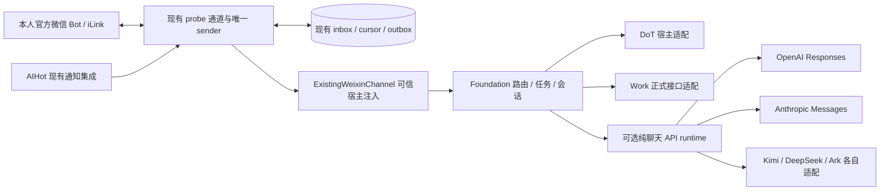

# 私人微信桥底座：本轮边界与部署门槛

微信入口长期保留，DoT／贾维斯是当前默认助手后端。新 `foundation/` 是隔离开发的可选路由模块，承接版本化请求、后端能力、任务和会话；微信收发继续由现有 `probe/` 负责。模型 API 是纯聊天执行能力，不能继承 DoT 的工具、记忆或权限。

图表示代码职责，不代表当前生产环境已经启用新后端。包导入不登录、不启动线程、不读凭据。新任务路径只在实际唯一协调者注入可信读取、绑定证明、后端和原 final sender 后成立；不能把构造适配器当已接通。现有DoT事件路径不因源码复制而被替换。

## 本轮取舍

- 保留原微信入站事务、稳定事件ID、媒体存储、原final账本及发送UNKNOWN语义；不另写长轮询/扫码/消费者。
- CowAgent按固定SHA逐函数提取纯协议逻辑，见COWAGENT-PROVENANCE.md；其内存去重、进程内锁、发送重试与正文日志不覆盖现有可靠性实现。
- 新SQLite仅记录可替换后端的路由/任务/会话与提交状态。它不是第二份微信账户或凭据库，也不能证明上游手机送达。
- 切换默认后端只影响之后的新任务；已运行任务保持原后端、模型与配置版本。默认不把旧后端历史、记忆或附件复制到新供应商。
- 初版API路径支持文本；媒体、stream、tools、取消和主动回调按实际能力声明。现有微信媒体可用性与模型理解能力分开验收。
- 原固定命令菜单和“额度”由原协调者处理。额度是本人当前Codex账户的官方工具查询，不等于API token用量或其它厂商余额。最近微信额度实测失败，不能在新底座勾选已修复。

## 状态与凭据

开发数据库必须放在隔离目录。不要把生产state指向demo。重启时运行中任务或发送不确定的任务保持unknown，不能重新提交模型或补发。后台服务、网络连接或真实微信消费者均未由新包自动创建。

模型API凭据在实际提交时由各自独立环境变量解析，不写入BackendRequest、模型上下文、health或Git。配置仅保存变量名；健康检查不会读取密钥，也不验证真实余额。缺凭据、缺权限、API请求未验证与mock通过分别记录。API运行成本与Codex订阅额度分开。

本轮没有实际请求任何新供应商。引入付费调用、迁移历史/媒体、注册常驻任务、切换生产消费者或重新绑定均需要按实际操作完成审阅后再执行。

## 与原主机和工作台的接续

现有Mac安装器和服务入口继续参考INSTALLATION.md；已有服务只能用接续流程。新的本地CLI提供离线demo、配置检查和任务状态，不冒充已安装的生产常驻服务。本轮不新起管理Web服务，不改变Mac工作台。

工作台未来应读取脱敏状态：当前默认后端/模型、配置版本、任务状态、UNKNOWN发送、后端health和用量。该端口只暴露固定状态，不能展示凭据、上下文token、私有正文或完整响应。需要HTTP管理界面时再以回环绑定和鉴权的具体方案接续。

## 生产切换与回滚SOP（未执行）

1. 核实当时实际部署版本、安装清单、唯一原协调者和有效订阅。旧Mac、其它目录或其它框架是否持有同Bot凭据要有独立证据，单个state锁不证明全环境唯一。
2. 完成新包全部离线验证、导出隐私扫描和哈希清单；准备精确配置差异。保留原生产代码、配置和消息数据库的一致备份。备份不放进公开仓库。
3. 宿主证明原DoT/Work正式路由、受理turn、最终结果、目标Mac和有界等待。缺接口的后端保持BLOCKED，不切成同名API助手。
4. 在明确授权窗口内只改原唯一协调者的任务路由。禁止平行消费同一Bot做灰度。若确需更换消费者，先有真实停旧/独占证据；凭据兼容时保留绑定，不为换模型扫码。
5. 本人用新的测试消息逐项验收原微信→真实后端→原final→手机唯一正确收件。accepted、模型完成和手机收件分别记录。模型失败、超时、重启、UNKNOWN也需演练。
6. 失败时停止新后端准入，恢复先前已验收的代码/路由配置；保留切换期间全部inbox/outbox/任务/claim/UNKNOWN。不得用旧数据库快照覆盖新发送记录。未知原请求只对账，不重跑。此前被拒的AppServer路线不作为回滚默认路径。

本轮可直接回滚隔离代码：弃用本地开发分支或退回本地snapshot提交；这不影响生产。没有生产切换，也没有数据库迁移需要执行回退。

## 来源和后续对标

AIHot继续保留原项目来源、MIT和作者说明，见AIHOT-PROVENANCE.md；它作为来源监控/通知集成存在，不冒称完整AIHot资讯站已在新Mac部署。人格、网页读取、Skills/MCP、记忆、知识库、调度和预算在可选能力层逐步接入，不能自动安装未知插件或同时启动两套任务调度。

后续每个功能按“上游证据／现有代码／本轮实现／模拟／真实联调／手机验收”记录。CowAgent上游更新先固定新SHA、审查差异和权限，再跑回归；不拉master覆盖生产。
